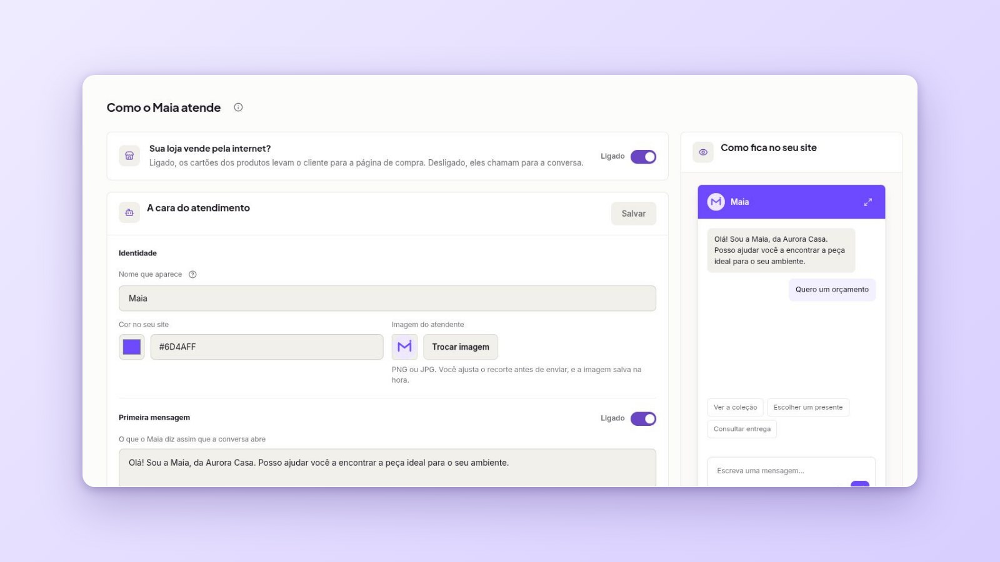
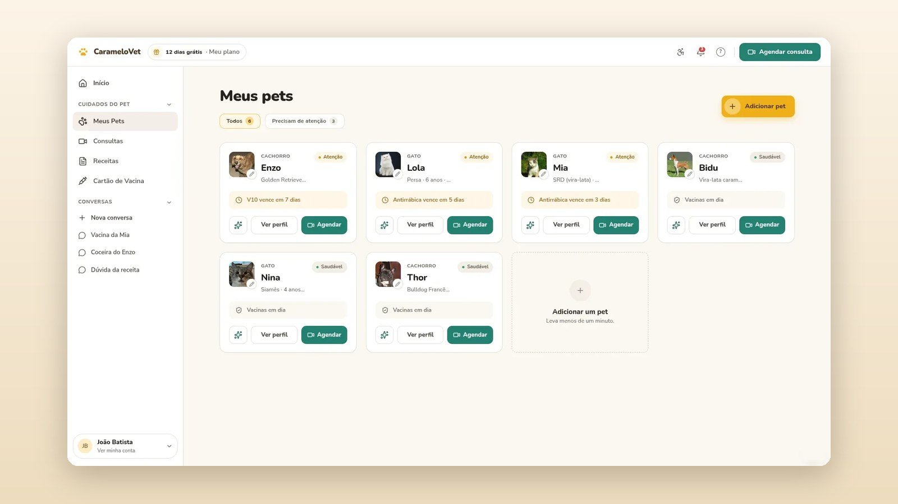
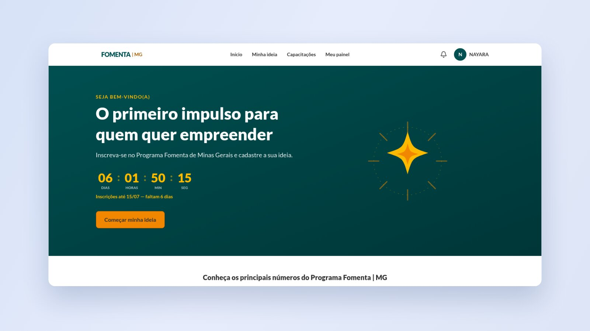

# João Batista

Full-stack developer in Brazil. I design and build custom systems: web
platforms, process automation and applied AI, taking care of everything from
the product design to the code in production.

🇧🇷 Desenvolvedor full stack. Construo sistemas sob medida: plataformas web,
automação de processos e IA aplicada, do design do produto ao código em
produção. [Resumo em português no fim da página.](#em-português)

**Stack:** Next.js · React · TypeScript · Python · FastAPI · PostgreSQL ·
WordPress · AI agents (RAG, tool use, multi-agent)

🌐 [joaobatista.tech](https://joaobatista.tech) ·
💼 [LinkedIn](https://www.linkedin.com/in/jo%C3%A3o-batista-cj-7934a1113/) ·
✉️ joaobatista081@gmail.com

---

## Featured work

These are real products I designed and developed end to end. The code is
private because they are commercial projects, so each one links to a full case
study with real screens.

### [Nika — AI platform for customer service](https://joaobatista.tech/en/projects/nika)

Multi-tenant SaaS where businesses explain themselves in natural language and
AI agents answer their customers on WhatsApp and on the website, grounded in
that knowledge. Product design, interfaces and full-stack development.

### [CarameloVet — veterinary telemedicine](https://joaobatista.tech/en/projects/caramelovet)

Telemedicine platform with three panels (pet owner, veterinarian, operations):
AI triage before the appointment, video consultation, medical records and
payments with automatic split. The whole product: three interfaces, API,
database and AI layer.

### [Fomenta — platform for innovation programs](https://joaobatista.tech/en/projects/fomenta)

Guided application flow for innovation grants: steps with visible progress,
autosave, a learning track and an AI copilot that knows the call for proposals
and helps the applicant write, with the person always in control.

---

## Open source

| Project | What it is |
|---|---|
| [louro](https://github.com/joaocorrea081/louro) | Free voice dictation on Linux: press a shortcut, speak, the text lands wherever your cursor is. Uses Chrome as a hidden speech engine, no API key and no model download. |
| [botzero](https://github.com/joaocorrea081/botzero) | Anti-spam for Contact Form 7: five invisible layers that block bots without captchas or external services. |
| [zapteam](https://github.com/joaocorrea081/zapteam) | Floating WhatsApp button for WordPress with a team popup, per-member schedule and online status. |
| [wpml-fix-ally-accessibility](https://github.com/joaocorrea081/wpml-fix-ally-accessibility) | One-file mu-plugin that fixes the Ally accessibility widget disappearing on WPML secondary languages. |

---

## Em português

Sou desenvolvedor full stack em Minas Gerais. Construo sistemas sob medida:
plataformas web, automação de processos e inteligência artificial aplicada,
cuidando do produto inteiro, do design à produção.

Os três projetos em destaque acima são produtos reais que desenhei e
desenvolvi de ponta a ponta. O código é privado por serem projetos comerciais;
cada um tem um estudo de caso completo no site, com telas reais:
[Nika](https://joaobatista.tech/projetos/nika),
[CarameloVet](https://joaobatista.tech/projetos/caramelovet) e
[Fomenta](https://joaobatista.tech/projetos/fomenta).

Quer conversar sobre um projeto? [joaobatista.tech](https://joaobatista.tech)
tem um formulário direto, ou me escreva em joaobatista081@gmail.com.
